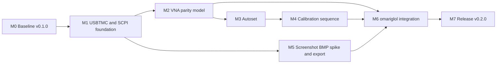

# NanoVNA USBFix — Milestones to v0.2.0

## Release framing

| Item | Value |
| --- | --- |
| Current release | **v0.1.0** (the shipped PCLK + USBTMC baseline; the existing [`CHANGELOG.md`](../CHANGELOG.md) entry is labelled `1.0.0` and will be reconciled to `v0.1.0`) |
| Target release | **v0.2.0** — unofficial firmware feature-complete against the omariglol DS1054Z-over-USB profile, plus USB autoset, USB calibration, and screenshot export |
| Official firmware | **Frozen.** [`patches/0001-usb-clock-pclk.patch`](../patches/0001-usb-clock-pclk.patch) and the official artifact stay byte-for-byte stable except for a confirmed enumeration/USB bug with a reproduction and regression test |
| Unofficial firmware | All v0.2.0 work lands here, gated by the existing `USBTMC=yes` build |
| Pinned upstream | NanoVNA-H `1.2.50`, commit `816495ebc8ca022149787ec2f9e058d6ce3bcb3b` |

### Release thesis

v0.1.0 proved that the NanoVNA-H can enumerate reliably with PCLK and expose a
USBTMC/SCPI interface. v0.2.0 makes that interface a **first-class instrument**
in omariglol: the same command depth the DS1054Z gets over USB, plus
VNA-specific automation that a scope does not need.

### Non-goals for v0.2.0

- No upstream fork. All changes remain patches against the pinned tarball.
- No JPG encoder. Screenshots are raw **320×240 16-bit BMP** (153,654 bytes with
  header), which is small enough to stream quickly over USB.
- No new large static RAM buffers. The F072 has 16 KiB RAM and the stock
  firmware already uses most of it.
- No official-firmware feature growth.

---

## Milestone map

---

## Definition of DS1054Z parity

Parity means **operation depth**, adapted to VNA semantics. The omariglol
DS1000Z profile in [`driver.rs`](/home/sam/projects/omariglol/crates/omariglol-core/src/driver.rs:495)
is the reference. Every DS1000Z command group must have a NanoVNA equivalent,
a documented deliberate omission, or a host-side composition.

| DS1054Z group | NanoVNA equivalent | Status | Target |
| --- | --- | --- | --- |
| `system` — identify, reset, clear, OPC, self-test, error queue | `*IDN?`, `*RST`, `*CLS`, `*OPC?`, `*TST?`, `:SYST:ERR?` with a real queue | Partial | M1 |
| `acquire` — run, stop, single, autoscale, force trigger, type, averages, depth, sample rate | resume, pause, single sweep, autoset, sweep-now, averaging, IFBW, points, measured sweep time | Partial | M2/M3 |
| `trigger` — mode, status, sweep, edge source/level/slope/coupling | sweep trigger mode, sweep status, single/continuous, external trigger if wired | Missing | M2 |
| `channel1..4` — display, scale, offset, coupling, probe, bandwidth, invert | trace display, dB/div, reference level, trace format, IFBW, phase invert, trace math | Partial | M2 |
| `timebase` — mode, scale, offset | frequency span, start/stop/center/span, CW | Partial | M2 |
| `measure` — Vpp, Vmax, Vmin, Vavg, Vrms, frequency, period, timing, duty, overshoot | log magnitude, phase, VSWR, return loss, impedance, group delay, Q, series/parallel equivalent | Partial | M2 |
| `waveform` — source, mode, format, points, preamble, data | S11/S21 binary data block, format, points, preamble, chunked full-sweep read | Partial | M1/M2 |
| `display` — data, type | BMP screenshot export, display pause/resume | Missing | M5 |
| `math` — display, operator | trace memory, trace math, limit lines | Missing | M2 |
| system extras — beeper | beeper, firmware version, build info, serial number | Partial | M1 |

### Host-side parity

The omariglol `NanoVNA USBFix` rich profile in
[`driver.rs`](/home/sam/projects/omariglol/crates/omariglol-core/src/driver.rs:440)
must expose names that the desktop app, CLI, Python API and workspace fan-out
already understand, plus VNA-specific additions. Firmware and host changes are
released together; a firmware command without its host profile is not done.

---

## M0 — v0.1.0 baseline and guardrails

**Goal:** Freeze the known-good baseline, make the release line unambiguous, and
put guardrails in place so every later change is measurable.

- [x] Official PCLK build enumerates as `0483:5740` on the affected unit.
- [x] Unofficial composite CDC + USBTMC build enumerates and answers `*IDN?`.
- [x] `:VNA:SWE:*`, `:VNA:FREQ`, `:VNA:PAUSE`, `:VNA:RESUME` and
      `:VNA:DATA:CHUNK?` implemented.
- [x] `:VNA:CMD` and `:VNA:CMD?` stock-shell escape hatch implemented.
- [x] Reproducible pinned build and `SHA256SUMS` verification.
- [x] CI builds both flavors and [`scripts/verify.sh`](../scripts/verify.sh:48)
      checks the unofficial symbols and official absence.
- [x] CDC shell regression is part of the manual matrix in
      [`docs/testing.md`](../docs/testing.md:65).
- [x] Reconcile project versioning: add `v0.1.0` to [`CHANGELOG.md`](../CHANGELOG.md:7)
      and document that the existing `1.0.0` entry is the v0.1.0 baseline.
- [x] Record the v0.1.0 baseline artifact sizes for both flavors in
      `docs/testing.md` so v0.2.0 has a real budget comparison.
- [x] Add a size-budget check to [`scripts/verify.sh`](../scripts/verify.sh:27):
      official must not grow; unofficial must stay below an agreed flash ceiling
      with a documented margin.
- [x] Capture the v0.1.0 SCPI transcript as a regression sample under
      `docs/testing/` for later protocol-diff tests.
- [x] Document the patch-series convention: one logical patch per feature, each
      must apply with `patch -p1` to the pinned tag.
- [x] Add self-contained udev install/uninstall scripts for USBTMC access.
- [x] Fix the omariglol generic USBTMC udev glob so it matches `fe0301`, not
      only `fe03:`.

**Exit criteria:** v0.1.0 is named consistently, CI fails on accidental official
growth, and there is a recorded SCPI baseline to diff against.

---

## M1 — USBTMC and SCPI foundation

**Goal:** Make the transport robust enough for binary and long-running VNA
operations before adding more commands. This is the base every later milestone
depends on.

### Transport

- [ ] Review the USBTMC response path against
      [`docs/architecture.md`](../docs/architecture.md:74) and remove the
      display-freeze trade-off where possible.
- [ ] Add a dedicated small transfer buffer or a streaming write path so a
      response larger than the LCD scratch buffer does not stall the UI.
- [ ] Implement abort-bulk-out / abort-bulk-in and recover cleanly if the host
      disconnects mid-response.
- [ ] Implement `READ_STATUS_BYTE`, `INITIATE_CLEAR`, `CHECK_CLEAR_STATUS` and
      `GET_CAPABILITIES` consistently, including the error bits.
- [ ] Make long operations (`:VNA:SWE:EXEC`, calibration, autoset) explicitly
      asynchronous or clearly blocking, with `*OPC?` as the completion signal.
- [ ] Add a command queue depth greater than one so a probe cannot drop a
      pending command.
- [ ] Ensure CDC shell and USBTMC command execution share VNA state safely
      through one execution point, not two concurrent parsers.

### SCPI foundation

- [x] Fix the v0.1.0 `:VNA:CMD?` hang: `info` and `version` timed out and wedged
      later USBTMC requests until a power cycle. The per-thread output routing
      and byte-path capture fix is in `0003-usbtmc-shell-output.patch`, and the
      fix was verified on hardware.
- [ ] Make the shell escape hatch abortable and add it to the hardware
      regression transcript.
- [x] Implement a real SCPI error queue with standard codes; replace the current
      constant `0,"No error"` response.
- [x] Add `*IDN?` build/serial fields sourced from MCU UID and build metadata.
- [x] Implement `*OPC?` that waits for the active sweep/calibration, not a
      constant `1`.
- [x] Implement `:SYST:VERS?`, `:SYST:ERR?`, `:SYST:ERR:COUN?` and
      `:SYST:BEEP`.
- [ ] Add a definite-length IEEE-488.2 block response mode for binary data, not
      only ASCII lines.
- [x] Make malformed commands non-fatal and always return a parseable error.
- [x] Add a `:VNA:ABOR` command that cancels a running sweep/autoset/calibration.

### Verification

- [ ] Add host-side protocol tests for headers, EOM, partial reads, zero-length
      packets and abort recovery.
- [ ] Add a soak test that runs thousands of queries and verifies no response
      desynchronization.
- [ ] Add a CI symbol check for the new transport entry points.

**Exit criteria:** A host can stream a multi-chunk binary response, abort it,
recover, and read a meaningful error queue without freezing the display or
requiring a power cycle.

---

## M2 — VNA measurement and control parity

**Goal:** Give the VNA the same operational depth as the DS1054Z profile:
acquisition, sweep geometry, traces, markers, measurements, trace math and
binary data transfer.

### Sweep and acquisition

- [x] Add sweep start/stop/center/span commands and queries.
- [x] Add point-count query and enforce the F072 `SWEEP_POINTS_MAX` limit with a
      clear error rather than silent clamping.
- [x] Add CW frequency commands and query (already partially present).
- [x] Add single-sweep, continuous-sweep, pause, resume and abort semantics that
      are independent of the UI.
- [x] Add sweep status and trigger-mode queries.
- [x] Add averaging count, averaging enable and IF bandwidth control.
- [x] Add output power control where the hardware supports it.
- [x] Expose measured sweep time and points-per-second telemetry.

### Traces and display model

- [ ] Define a trace model: S11, S21, and derived trace types.
- [ ] Add trace display on/off, trace format (log magnitude, linear magnitude,
      phase, Smith, polar, VSWR, resistance/reactance, group delay).
- [ ] Add dB/div and reference-level equivalents of scope `scale` and `offset`.
- [ ] Add trace memory and trace math (`data / memory`, `data - memory`, etc.).
- [ ] Add limit lines or threshold reporting for pass/fail automation.
- [ ] Add phase invert and electrical-delay compensation.

### Markers and measurements

- [ ] Add markers with frequency and value readback.
- [ ] Add marker search: peak, minimum, target, bandwidth/Q.
- [ ] Add measurement readouts: log magnitude, phase, VSWR, return loss, complex
      impedance, series/parallel equivalent, group delay, Q.
- [ ] Add a `:VNA:MEAS:CLE` equivalent and a measurement query set that
      `measure.rs` can consume.
- [ ] Add time-domain transform controls and readback if supported by upstream.

### Data transfer

- [x] Add binary full-sweep transfer with an IEEE-488.2 block
      (`:VNA:DATA:BLOCK?`; patch `0005-m2-binary-data-transfer.patch`).
- [x] Add a waveform-style preamble query: points, start, step, format, units
      (`:VNA:DATA:PRE?`).
- [x] Keep `:VNA:DATA:CHUNK?` for compatibility and make it binary-capable
      (fourth `BIN`/`BLOCK` argument).
- [ ] Add per-point calibration-applied vs raw data selection.
- [x] Document the exact byte layout and endianness in
      [`docs/usb-api.md`](../docs/usb-api.md:59).

**Exit criteria:** Every command group in the DS1000Z reference table has a
documented NanoVNA equivalent, and a full 101-point S11 and S21 sweep can be
read in one binary transfer.

---

## M3 — USB-driven autoset

**Goal:** One command performs a safe, explainable measurement-driven setup, and
reports what it chose.

### Algorithm

- [ ] Define the autoset input: allowed frequency range, points, power, IFBW and
      sweep time budget.
- [ ] Run a wide reconnaissance sweep at reduced resolution.
- [ ] Detect peaks, notches, band edges and noise floor.
- [ ] Choose start/stop and center/span around the feature of interest, or a
      broadband span when the response is flat.
- [ ] Choose IFBW, averaging and point count from measured noise and the sweep
      time budget.
- [ ] Re-sweep at the chosen settings and validate that the feature is inside the
      span and above the noise floor.
- [ ] Return a structured result: chosen range, points, IFBW, averaging, power,
      detected feature, and a confidence/status code.
- [ ] Add a dry-run mode that reports the proposed settings without applying
      them.

### Safety and control

- [ ] Never persist autoset settings until the host confirms.
- [ ] Add timeout and abort handling.
- [ ] Keep autoset out of interrupt context and out of the CDC shell parser.
- [ ] Add `:VNA:AUTO`, `:VNA:AUTO?`, `:VNA:AUTO:DRY` and `:VNA:AUTO:ABOR`.

### Verification

- [ ] Test against open, short, 50 Ω load, a known filter and a known antenna.
- [ ] Add a regression fixture of raw sweep data and expected chosen settings.
- [ ] Add a host-side example in omariglol.

**Exit criteria:** `:VNA:AUTO` on an unknown DUT produces a span that contains
the dominant feature, completes without host intervention, and leaves the
instrument in a usable continuous-sweep state.

---

## M4 — USB-driven calibration sequence

**Goal:** A host can run a guided calibration without touching the device UI,
then save, recall and validate the result.

### Calibration workflow

- [ ] Define a calibration session model: type, ports, frequency range, points,
      kit, current step, state.
- [ ] Add 1-port SOL calibration: open, short, load, optional isolation.
- [ ] Add 2-port response calibration: thru, optional isolation.
- [ ] Add per-step commands and queries so the host can prompt the operator.
- [ ] Add step validation with a tolerance check and a clear failure reason.
- [ ] Add `:VNA:CAL:STAR`, `:VNA:CAL:STEP`, `:VNA:CAL:STAT?`,
      `:VNA:CAL:SAVE`, `:VNA:CAL:LOAD`, `:VNA:CAL:ABOR`.
- [ ] Add calibration status to every measurement response: calibrated,
      uncalibrated, stale, or out of range.
- [ ] Add a calibration expiry policy based on a settings hash, frequency range
      or explicit invalidation.
- [ ] Add a non-destructive "preview" mode that applies calibration to one
      sweep without persisting it.

### Calibration kit model

- [ ] Define a kit description: open/short/load standards, delays, losses.
- [ ] Add a default kit and a way to select a stored kit.
- [ ] Add kit query/response so the host can display what was used.

### Verification

- [ ] Add a hardware procedure that calibrates, measures a known load, and
      asserts return loss and VSWR limits.
- [ ] Add tests for abort, out-of-range frequencies, wrong steps and repeated
      saves.
- [ ] Add host examples for the full SOL sequence.

**Exit criteria:** A host script can run a complete SOL calibration, save it,
recall it, and prove the result by measuring a known load, all over USBTMC.

---

## M5 — Screenshot BMP spike and export

**Goal:** Export the 320×240 display over USB as a 16-bit BMP without a JPG
encoder and without a 150 KiB RAM buffer. The JPG idea is explicitly dropped:
a 320×240 16-bit BMP is about **153,654 bytes** including the header and is fast
enough over USB.

### Spike first — [`docs/spikes/screenshot-bmp.md`](../docs/spikes/screenshot-bmp.md)

- [ ] Inspect upstream `capture` and the LCD read path in the pinned tree; record
      whether pixels come from the LCD GRAM or a RAM framebuffer.
- [ ] Measure the current display pause and USB throughput for a streamed
      transfer.
- [ ] Compare transfer strategies:
      - stateful chunk reads with a start/count command and a small staging
        buffer;
      - one IEEE-488.2 definite-length stream written directly to the bulk-in
        endpoint;
      - host-side chunk reassembly vs firmware-generated BMP header.
- [ ] Confirm the BMP layout: 16-bit `BI_BITFIELDS` RGB565, 54-byte header,
      640-byte rows with no padding, bottom-up or top-down row order.
- [ ] Resolve the `spi_buffer` contention between the LCD read path and the
      USBTMC response path.
- [ ] Record the measured transfer time and the largest RAM/flash cost.
- [ ] Decide whether firmware emits BMP bytes or raw RGB565 for the host to wrap.

### Implementation

- [ ] Add `:VNA:DISP:DATA? [start],[count]` returning a chunk of the framebuffer.
- [ ] Add `:VNA:DISP:SIZE?` returning width, height, bits per pixel and stride.
- [ ] Add `:VNA:DISP:DATA:ABOR` to cancel a stalled transfer.
- [ ] Add a display pause/resume handshake so a long read does not corrupt the
      image or freeze the UI indefinitely.
- [ ] Emit either a complete BMP stream or raw RGB565 with an explicit format
      marker.
- [ ] Add a host assembler in omariglol's screenshot path.
- [ ] Add a golden-image test using a known on-screen pattern.
- [ ] Update [`docs/usb-api.md`](../docs/usb-api.md:109) and remove the old
      warning that screenshots must use CDC.

**Exit criteria:** `riglol screenshot` over USBTMC produces a byte-identical BMP
on repeated captures of a static screen, in one transfer, without a JPG encoder
and without exceeding the RAM budget.

---

## M6 — omariglol integration and driver parity

**Goal:** The host side treats the NanoVNA as a first-class VNA with the same
UX depth as the DS1054Z, and the two repositories agree on one contract.

### Driver profile

- [ ] Expand `nanovna_commands()` in
      [`driver.rs`](/home/sam/projects/omariglol/crates/omariglol-core/src/driver.rs:440)
      to mirror the DS1000Z groups: acquire, trigger, traces, timebase,
      measurements, waveform, display, math and system.
- [ ] Add VNA-specific operations for autoset, calibration, markers and trace
      math.
- [ ] Map `autoscale` to `:VNA:AUTO` so the existing workspace fan-out in
      [`autoscale.rs`](/home/sam/projects/omariglol/crates/omariglol-core/src/autoscale.rs:96)
      works unchanged.
- [ ] Add measurement queries that [`measure.rs`](/home/sam/projects/omariglol/crates/omariglol-core/src/measure.rs:59)
      can collect without special-casing.
- [ ] Add a NanoVNA screenshot profile to
      [`screenshot.rs`](/home/sam/projects/omariglol/crates/omariglol-core/src/screenshot.rs:90),
      using the new BMP command and `ImageFormat::Bmp`.

### CLI, Python and UI

- [ ] Add `riglol vna autoset`, `riglol vna cal` and `riglol screenshot --usb`
      examples.
- [ ] Extend [`examples/scpi/19_nanovna.sh`](/home/sam/projects/omariglol/examples/scpi/19_nanovna.sh:26)
      to cover parity operations, autoset, calibration and screenshot.
- [ ] Expose the new operations through the Python scripting API.
- [ ] Add VNA panels or sections for sweep, traces, markers, calibration and
      screenshot in the desktop app.
- [ ] Add a workspace-level VNA snapshot: screenshot plus measurement CSV.

### Contract and tests

- [ ] Add a firmware/host contract document or shared fixture set so command
      names and response shapes cannot drift.
- [ ] Add host tests against a recorded SCPI transport fixture.
- [ ] Add an end-to-end hardware test script that runs the full contract.

**Exit criteria:** `riglol driver` on the NanoVNA lists the parity surface, and
the desktop app can identify, sweep, measure, autoset, calibrate and screenshot
without any VNA-specific escape hatch.

---

## M7 — v0.2.0 release hardening

**Goal:** Ship a documented, reproducible, recoverable v0.2.0 with evidence.

- [ ] Split the firmware patch series into logical patches and update
      [`patches/README.md`](../patches/README.md:6).
- [ ] Keep the official artifact unchanged; assert this by comparing hashes
      against M0.
- [ ] Update [`docs/usb-api.md`](../docs/usb-api.md:1) with every new command,
      response format, error code and binary layout.
- [ ] Update [`docs/architecture.md`](../docs/architecture.md:37) with the new
      transport, buffering and calibration state model.
- [ ] Update [`docs/testing.md`](../docs/testing.md:17) with the hardware matrix:
      enumeration, parity, autoset, SOL calibration, BMP screenshot, abort,
      recovery, CDC regression.
- [ ] Update [`README.md`](../README.md:56) and [`CHANGELOG.md`](../CHANGELOG.md:1)
      for v0.2.0.
- [ ] Add release notes with known limitations: input-only reflectometry on
      S11/S21 hardware, calibration accuracy, display pause during screenshot.
- [ ] Verify artifact size, symbols, checksums and DFU recovery.
- [ ] Tag `v0.2.0`, publish both flavors, and keep v0.1.0 assets available.
- [ ] Update the omariglol branch/PR with the matching host changes and link it
      from the release notes.

**Exit criteria:** A user can flash the v0.2.0 unofficial image, run the
documented hardware matrix, and complete identify → sweep → measure → autoset →
calibrate → screenshot entirely over USB. The official v0.1.0 image is
unchanged.

---

## Suggested additions beyond the requested scope

These are ordered by value and fit for v0.2.0; anything not completed moves to a
future milestone rather than silently expanding the release.

### High value, low risk

- [ ] **Deterministic serial number** in `*IDN?` from the MCU UID, so multiple
      VNAs are distinguishable in workspaces.
- [ ] **Status byte and SRQ** on sweep complete, calibration step complete and
      error queue non-empty.
- [ ] **Firmware health telemetry**: battery voltage, board temperature, USB
      error counters, last reset cause and sweep timing.
- [ ] **`*RST` that actually restores a documented safe state**, including
      continuous sweep and default trace format.
- [ ] **Touchstone export** (`.s1p` and `.s2p`) host-side from the binary sweep
      data.
- [ ] **CSV export** through the existing omariglol `CsvLogger`.
- [ ] **Save/recall slots** exposed over SCPI with names or indices.
- [ ] **Reboot to DFU** command behind an explicit confirmation, for recovery
      automation.

### Medium value

- [ ] **Continuous sweep synchronization** so a host can request "next completed
      sweep" instead of racing a timer.
- [ ] **Streaming data mode** that pushes completed sweeps to the host without a
      query per point.
- [ ] **Calibration interpolation** across frequency ranges and warning when a
      measurement falls outside the calibrated span.
- [ ] **Limit-line pass/fail** evaluation in firmware for automated test stands.
- [ ] **Trace averaging across sweeps** with a reset command.
- [ ] **USB descriptor polish**: serial string, product string, and a stable
      interface numbering contract.
- [ ] **CDC/USBTMC concurrency test** that drives both interfaces at once and
      proves VNA state is never corrupted.

### Future / larger

- [ ] **TCP or Wi-Fi bridge** is out of scope for the F072; document it as a
      host-side possibility only.
- [ ] **On-device JPG or PNG encoding** remains explicitly rejected for v0.2.0.
      Revisit only if USB throughput or host storage makes BMP impractical.
- [ ] **S21 fixture de-embedding** and advanced calibration algorithms as a
      separate spec.
- [ ] **Companion mode** where the host UI mirrors the device display in real
      time.

---

## Cross-cutting acceptance criteria

- [ ] The official PCLK image is unchanged except for a documented bug fix.
- [ ] Every new firmware command is covered by [`docs/usb-api.md`](../docs/usb-api.md:1).
- [ ] Every new firmware command has at least one host test or recorded fixture.
- [ ] Every new feature has a `:VNA:ABOR`-safe exit path.
- [ ] No feature adds a static buffer larger than the agreed RAM budget.
- [ ] `make dist` passes on CI with the new size and symbol checks.
- [ ] The CDC shell still works for every manual regression run.
- [ ] DFU recovery is tested after every risky firmware change.
- [ ] v0.2.0 can be explained by one sentence per milestone in the release notes.

---

## Risks and mitigations

| Risk | Impact | Mitigation |
| --- | --- | --- |
| 16 KiB RAM cannot hold a 150 KiB BMP | Screenshot blocked | Chunked streaming spike in M5; no JPG; no full-frame buffer |
| `spi_buffer` is shared by LCD and USBTMC | Deadlock or corrupted response | M5 spike resolves ownership; abort path added in M1 |
| Long calibration/autoset blocks the main loop | Watchdog or frozen UI | `*OPC?`, abort, bounded recon sweeps, progress status |
| SCPI surface grows beyond flash | Image no longer fits | CI size budget in M0; feature gating and patch split |
| Host and firmware drift | Driver commands fail | Shared contract fixtures and end-to-end test in M6 |
| Official firmware accidentally changes | Breaks the project promise | Hash comparison and symbol guard in M0/M7 |
| Calibration math is wrong or unvalidated | Misleading measurements | Known-load acceptance test, calibration status on every read |
| USBTMC binary transfer desynchronizes | Host hangs | Definite-length blocks, abort/clear, soak test in M1 |
